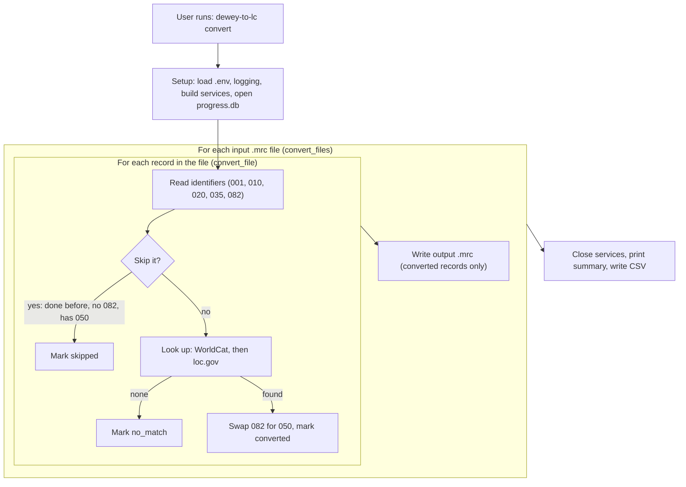

# How dewey-to-lc Uses the WorldCat API

Oct 15, 2026 · Rob OConnell

dewey-to-lc asks OCLC's WorldCat for the Library of Congress call number other libraries already assigned to the same book, then writes it into our MARC record in place of the Dewey number.

## The short version

There is no formula that turns a Dewey number into an LC number, so the tool borrows one. WorldCat is OCLC's shared catalog, and most books in it already carry an LC call number assigned by another library.

For each record in a FOLIO export, the tool:

1. Pulls out the identifiers it can match on: OCLC number (035), LCCN (010) and ISBN (020).
2. Asks WorldCat for that book's LC call number.
3. Removes the 082 (Dewey) field and adds an 050 (LC) field with what WorldCat returned.

If WorldCat finds nothing, the tool tries the free loc.gov catalog next. Anything still unmatched is flagged in the CSV report for a cataloger to assign by hand in Classification Web.

## How one record gets looked up

The tool tries the most precise identifier first and stops at the first LC number it finds. Every path ends with an OCLC number, because the LC lookups only accept one.

1. **OCLC number on the record?** Ask WorldCat for the record's classification directly.
2. **No luck, but there's an LCCN?** Search WorldCat by LCCN to find the matching OCLC number, then repeat step 1 with it.
3. **Still nothing, but there are ISBNs?** Search by each ISBN in turn the same way.
4. **WorldCat came up empty?** Hand the record to the loc.gov lookup (separate, no credentials needed).
5. **Nothing anywhere?** Mark the record `no_match` in the report for manual review.

Records that have no 082, or already have an 050, are skipped and never sent to WorldCat.

## The three WorldCat calls

The tool uses three endpoints of OCLC's **WorldCat Metadata API**. It doesn't call them by hand: the open-source Python library [bookops-worldcat](https://github.com/BookOps-CAT/bookops-worldcat) wraps them.

| Call | What it's for | What comes back | What the tool keeps |
| --- | --- | --- | --- |
| `GET /search/classification-bibs/{oclcNumber}` | Main lookup: "what call numbers do libraries use for this book?" | JSON with the most popular LC and Dewey numbers, e.g. `{"lc": {"mostPopular": ["HM742 .H55 2010"]}}` | The first LC number, split at the first space into 050 $a (`HM742`) and $b (`.H55 2010`) |
| `GET /search/brief-bibs?q=...` | Finding an OCLC number when the record lacks one | A list of short matching records | The OCLC number of the first match |

Searches use WorldCat index prefixes: `ln:` for LCCN and `bn:` for ISBN, e.g. `bn:9780134444321`.

## What WorldCat sends back

The examples below are real responses, captured on Oct 15, 2026 with our WSKey. They are not hand-written samples.

- **Where OCLC documents this:** the full field reference is OCLC's interactive API explorer at [developer.api.oclc.org](https://developer.api.oclc.org/wc-metadata-v2). It loads with JavaScript, so open it in a browser. The classification endpoint is also described in OCLC's [October 2023 release notes](https://help.oclc.org/Librarian_Toolbox/OCLC_APIs/Metadata_API_2.0_release_notes_and_known_issues/2023_Metadata_API_2.0_release_notes/095WorldCat_Metadata_API_2.0_release_notes%2C_October_2023), with a sample response.
- **Base URL:** every call goes to `https://metadata.api.oclc.org/worldcat/...`. bookops-worldcat builds the URLs.
- **Test records:** OCLC# 41266045 (the record `check_credentials.py` uses) and ISBN 9780134444321 (*Starting Out with Python*).

### Classification: `GET /search/classification-bibs/{oclcNumber}`

Used by `_get_classification()`. It returns a small JSON object holding the most popular LC and Dewey numbers. Per OCLC, they come from the record with the most library holdings in the book's "work cluster" (all editions and copies of the same work).

Real response for OCLC# 41266045:

```json
{
  "dewey": { "mostPopular": ["808.06/8"] },
  "lc": {
    "mostPopular": [
      "PZ7.R79835 Har 1999",
      "PR6068.O93 H365 1999"
    ]
  }
}
```

| Field | Type | Meaning |
| --- | --- | --- |
| `lc.mostPopular` | list of strings | Full LC call numbers, most popular first. **Can hold more than one.** |
| `dewey.mostPopular` | list of strings | Full Dewey numbers. The tool ignores these. |

When WorldCat has nothing (tried with a made-up OCLC#), it still returns HTTP 200, just with empty lists:

```json
{ "dewey": { "mostPopular": [] }, "lc": { "mostPopular": [] } }
```

**What the code does with it:** takes `lc.mostPopular[0]` and drops the rest. In the example above that's `PZ7.R79835 Har 1999`, a children's-literature number. The second option, `PR6068.O93 H365 1999` (English literature), is silently discarded, and an academic library might prefer it. An empty list means WorldCat has no LC number for that OCLC#.

### Search: `GET /search/brief-bibs?q=...`

Used by `_oclc_from_search()`. It returns a count plus a list of short ("brief") records. bookops adds default parameters to the request, notably `orderBy=bestMatch` and `limit=10`, so results come best match first, up to 10 at a time.

Real response for `q=bn:9780134444321`. WorldCat found 3 records; only the first is shown here:

```json
{
  "numberOfRecords": 3,
  "briefRecords": [
    {
      "oclcNumber": "966634090",
      "title": "Starting out with Python",
      "creator": "Tony Gaddis",
      "date": "2018",
      "machineReadableDate": "2018",
      "language": "eng",
      "generalFormat": "Book",
      "specificFormat": "PrintBook",
      "edition": "Fourth edition",
      "publisher": "Pearson",
      "publicationPlace": "New York, NY",
      "isbns": ["9780134444321", "0134444329", "9780134543666", "..."],
      "mergedOclcNumbers": ["962011138", "973292034", "..."],
      "catalogingInfo": {
        "catalogingAgency": "DLC",
        "transcribingAgency": "DLC",
        "catalogingLanguage": "eng",
        "levelOfCataloging": " "
      }
    }
  ]
}
```

| Field | Meaning | Used by the tool? |
| --- | --- | --- |
| `numberOfRecords` | Total matches | No |
| `briefRecords[].oclcNumber` | The record's OCLC number, as a string | **Yes**, from the first record only |
| `title`, `creator`, `date`, `edition`, `publisher` | Basic description | No, but useful for checking a match by eye |
| `isbns` | Every ISBN on the record, other formats included (10 here) | No |
| `mergedOclcNumbers` | Older OCLC numbers merged into this record | No |
| `catalogingInfo.catalogingAgency` | Who created the record. `DLC` = Library of Congress | No |

With no matches, WorldCat returns HTTP 200 and **no `briefRecords` key at all**:

```json
{ "numberOfRecords": 0 }
```

The code handles this safely with `.get("briefRecords", [])`.

## Credentials and sign-in

WorldCat needs an OCLC API key, called a **WSKey**, which comes as a client ID plus a secret. Keys are requested through OCLC's [WSKey portal](https://platform.worldcat.org/wskey/), and ours must include the `WorldCatMetadataAPI` scope.

- The ID and secret live in a local `.env` file as `WORLDCAT_CLIENT_ID` and `WORLDCAT_CLIENT_SECRET`. That file is git-ignored and never committed.
- At startup the tool trades the key for a short-lived access token (standard OAuth "client credentials" sign-in). bookops-worldcat handles this and reuses one session for the whole run.
- Without credentials the tool still runs, but only uses loc.gov, so more records end up needing manual review.

## Things worth knowing

- **Speed limit:** the tool waits so it sends at most 1 WorldCat request per second by default (`WORLDCAT_RATE_LIMIT`, or `--rate-limit`). One record can take up to 3 calls per identifier tried, so large batches take a while.
- **Interrupted runs resume:** progress is saved to a SQLite file, so a rerun skips records already done instead of calling WorldCat again.
- **"Most popular" isn't checked:** the tool takes the most common LC number other libraries use. That is usually right but isn't verified by a person, so spot-checking is worthwhile.
- **First search match wins:** an LCCN or ISBN search uses the first result only. An ISBN shared across editions could match a different edition.
- **Call-number splitting is simple:** the class/item split happens at the first space, which suits typical numbers like `HM742 .H55 2010` but not every format.
- **Errors don't stop the run:** a failed WorldCat call is logged and the tool moves to the next option.
- **Naming mismatch:** the README calls this the "WorldCat Search API v2", but the code uses the **WorldCat Metadata API**. Use the Metadata API name when talking to OCLC.
- **Unused code:** `worldcat.py` still has a fallback (`_get_marcxml_050`, `_extract_050_from_marcxml`) that requests the full record from `/manage/bibs`. Our key isn't allowed to read that endpoint (HTTP 401), so it never succeeds, and this doc leaves it out.
- **Several LC numbers can come back:** the tool keeps only the first. For OCLC# 41266045 that is a children's-literature number (PZ7) over an English-literature one (PR).

## Try it yourself

From the project folder, with `.env` filled in, run:

```bash
python3 check_credentials.py
```

It signs in to WorldCat, asks for the classification of one known book (OCLC# 41266045) and prints the LC and Dewey numbers it gets back. It also checks that loc.gov is reachable. That one exchange is the whole WorldCat idea in miniature: send an OCLC number, get a call number back.

## Code walkthrough

This section follows one record through the code, in the order things run. Paths are relative to `src/dewey_to_lc/` unless they start from the repo root.

### Workflow: from command to finish



A run is two nested loops: files, then records. Each record is looked up and its outcome saved to `progress.db` straight away, but converted records are written to the output `.mrc` only after the file's last record.

### Call order

Everything below runs after `dewey-to-lc convert records.mrc`. Indented steps happen inside the step above them.

0. **Before any command runs:** `pyproject.toml` maps the `dewey-to-lc` command to `cli()` in `cli.py`. Importing `cli.py` runs `load_dotenv()` at module level, which copies `.env` into environment variables. Click then parses the arguments and fills any missing options from those variables.
1. `convert_cmd(...)` (`cli.py`): the whole run lives inside this function.
   1. `_setup_logging(verbose)`
   2. `_build_lookup_services(id, secret, rate_limit)` creates `WorldCatLookup(...)` and `LocGovLookup(...)`. Nothing is contacted yet.
   3. `ProgressTracker(db)` (`progress.py`) opens or creates `progress.db` and runs `_init_schema()`.
   4. `Converter(services, tracker, output_dir, resume)` (`converter.py`) just stores its settings.
   5. `converter.convert_files(paths)` calls `convert_file(path)` once per input file:
      1. `read_marc_file(path)` (`marc_utils.py`) yields records one at a time.
      2. For each record:
         1. `extract_identifiers(record)` returns a `RecordIdentifiers`.
         2. `_safe_control_number(ids, index)` uses the 001, or `record-000042` if there isn't one.
         3. `tracker.mark_pending(...)` adds a row to the database if it isn't there yet.
         4. Skip checks, in order: `tracker.is_processed()` (only when resuming), then `has_dewey()`, then `has_lc_classification()`. Any hit calls `tracker.mark_skipped()` and moves to the next record.
         5. `_cascade_lookup(ids, services)` calls `WorldCatLookup.lookup(ids)`. The first time, `_get_session()` signs in to OCLC; this is the run's first network call. Then come `_throttle()`, `_get_classification()`, `_extract_lc_from_classification()` and `_split_lc_call_number()`, plus `_oclc_from_search()` when it has to search by LCCN or ISBN. If WorldCat returns `None`, it calls `LocGovLookup.lookup(ids)`.
         6. No result: `tracker.mark_no_match()`.
         7. A result: `apply_lc_classification(record, ...)` edits the record in memory, the record joins a list of converted records, and `tracker.mark_converted(...)` saves the outcome.
      3. After the file's last record: `write_marc_file(converted, output_dir/<same filename>)`, only if at least one record converted.
   6. `svc.close()` for each service, in a `finally` block, so it runs even after a crash.
   7. `print_summary(tracker)` (`report.py`) prints the counts.
   8. `write_csv_report(tracker, report)` (`report.py`) writes one CSV row per record in the database.
   9. Prints the output paths, and a warning if any record had no match.
   10. `tracker.close()`

**The other two commands:**

- `dewey-to-lc resume records.mrc` just calls `convert_cmd` with the file names. Every other option falls back to its default.
- `dewey-to-lc report` runs only steps 3, 7, 8 and 10: it rebuilds the CSV from `progress.db` without contacting any API.

### How a run ends

A finished run leaves three things behind:

| Output | Default path | Holds |
| --- | --- | --- |
| Converted MARC | `./output/<input file name>` | Only the records converted **in this run**, ready for FOLIO import |
| CSV report | `./conversion_report.csv` | One row per record ever seen, with its status and LC number |
| Progress database | `./progress.db` | The same per-record status. It is kept between runs and is what makes resuming possible |

The command exits normally even when records had no match or hit errors, so check the summary and the report rather than the exit code.

**Interrupted runs: known problem.** Records are marked converted in `progress.db` as they are processed, but the `.mrc` file is written only after a file's last record. That causes two failures:

- **If a run stops mid-file** (Ctrl-C, crash, lost network), the records converted so far are never written to the `.mrc`, yet the database says they're done.
- **On resume** those records are skipped, and the output file is rewritten with only the newly converted records. The earlier conversions are missing from the `.mrc`, though they still appear in the CSV.

Until that's fixed, rerun an interrupted file with `--no-resume`. That repeats every lookup but produces a complete `.mrc`.

Two smaller points:

- Records marked `no_match` or `error` count as done, so a resume won't retry them.
- `resume` ignores custom `--db` and `--output-dir` paths. If the first run used custom paths, use `convert` with the same flags instead.

### File map

| File | Role in the WorldCat flow |
| --- | --- |
| `cli.py` | Reads credentials from flags or `.env` and builds the list of lookup services: WorldCat first, loc.gov second |
| `converter.py` | Loops over every MARC record, decides whether to look it up, and runs the services in order (`_cascade_lookup`) |
| `marc_utils.py` | Pulls OCLC#, LCCN and ISBN out of a record; swaps 082 for 050 afterwards |
| `lookup/base.py` | The shared interface every lookup service follows (`LookupService`) and its result object (`LookupResult`) |
| `lookup/worldcat.py` | All the WorldCat-specific code: sign-in, the three API calls, response parsing |
| `lookup/loc_gov.py` | The loc.gov fallback, used only when WorldCat returns nothing |
| `progress.py` | SQLite tracker that records each record's outcome so reruns skip finished ones |
| `check_credentials.py` (repo root) | Standalone script that proves the WorldCat key works |
| `tests/test_worldcat_lookup.py` (repo root) | Unit tests for `worldcat.py`, with the API faked |

### Step 1: reading identifiers (`marc_utils.py`)

`extract_identifiers(record)` turns a pymarc `Record` into a small `RecordIdentifiers` dataclass. The WorldCat code only ever sees this object, never the raw MARC.

```python
@dataclass
class RecordIdentifiers:
    lccn: str | None = None          # 010 $a
    isbn: list[str] = field(default_factory=list)  # every 020 $a
    oclc_number: str | None = None   # 035 $a
    dewey: str | None = None         # 082 $a
    title: str | None = None         # 245 $a + $b, for the report
    control_number: str | None = None  # 001
```

The cleanup rules matter, because they decide what gets sent to WorldCat:

- **OCLC number:** checks each 035 $a for `(OCoLC)`, `OCoLC`, `ocn` or `ocm` followed by digits, keeps just the digits, and stops at the first match. So `(OCoLC)ocm41266045` becomes `41266045`.
- **ISBN:** cuts at the first space or `(` and removes hyphens. So `978-0-13-444432-1 (pbk.)` becomes `9780134444321`. All ISBNs are kept, in record order.
- **LCCN:** the first 010 $a, trimmed but otherwise sent as-is.

### Step 2: wiring it up (`cli.py`, `lookup/base.py`, `converter.py`)

**The interface.** Every lookup source follows the same small contract in `lookup/base.py`, so the converter doesn't care which API it's talking to:

```python
class LookupService(ABC):
    def lookup(self, identifiers: RecordIdentifiers) -> LookupResult | None: ...
    @property
    def name(self) -> str: ...   # "worldcat" or "loc.gov", shown in the report

@dataclass
class LookupResult:
    lc_class: str              # goes into 050 $a, e.g. "HM742"
    lc_item: str | None = None # goes into 050 $b, e.g. ".H55 2010"
    source: str = "unknown"
```

**Building the list.** `_build_lookup_services()` in `cli.py` creates a `WorldCatLookup` only if both the client ID and secret are present (from `--worldcat-id` / `--worldcat-secret` or the `WORLDCAT_CLIENT_ID` / `WORLDCAT_CLIENT_SECRET` env vars). It always adds `LocGovLookup` after it. The order of this list is the fallback order.

**Running the cascade.** For each record, `converter.py` first skips records with no 082 or an existing 050. It then calls `_cascade_lookup(ids, services)`, which asks each service in turn and returns the first non-`None` result:

```python
for service in services:
    try:
        result = service.lookup(identifiers)
        if result is not None:
            return result
    except Exception as exc:
        logger.warning("Lookup service '%s' raised an exception: %s", service.name, exc)
return None
```

Because of that `try`, a WorldCat crash just falls through to loc.gov instead of stopping the run.

### Step 3: the `WorldCatLookup` class (`lookup/worldcat.py`)

This is the heart of the integration. Its methods split into three layers: setup, one method per API call, and the logic that chains them.

| Method | Layer | What it does |
| --- | --- | --- |
| `__init__(client_id, client_secret, rate_limit=1.0)` | Setup | Stores credentials and turns the rate limit into a minimum gap between calls (`1 / rate_limit` seconds). Does **not** connect yet. |
| `_get_session()` | Setup | On first use, creates a `WorldcatAccessToken` (scope `WorldCatMetadataAPI`) and a `MetadataSession`, then caches the session for the rest of the run. |
| `_throttle()` | Setup | Sleeps if the last call was too recent. Called at the start of every API method. |
| `_get_classification(session, oclc)` | API call | `session.bib_get_classification(oclcNumber=...)`; on HTTP 200, returns the first "most popular" LC number as a string. |
| `_oclc_from_search(session, query)` | API call | `session.brief_bibs_search(q=...)`; on 200, returns the OCLC number of the first `briefRecords` hit. |
| `_lookup_by_oclc(session, oclc)` | Logic | Calls `_get_classification` and wraps a hit in a `LookupResult`. |
| `lookup(identifiers)` | Logic | The public entry point: OCLC# first, then LCCN search, then each ISBN search. |
| `close()` | Setup | Closes the HTTP session. |

The public method reads almost like the plain-English steps above:

```python
def lookup(self, identifiers):
    session = self._get_session()

    # 1. Direct OCLC# lookup
    if identifiers.oclc_number:
        result = self._lookup_by_oclc(session, identifiers.oclc_number)
        if result:
            return result

    # 2. LCCN search -> OCLC# -> lookup
    if identifiers.lccn:
        oclc = self._oclc_from_search(session, f"ln:{identifiers.lccn}")
        if oclc:
            result = self._lookup_by_oclc(session, oclc)
            if result:
                return result

    # 3. Same again for each ISBN, using "bn:"
    for isbn in identifiers.isbn:
        ...
    return None
```

**Error handling.** Each of the three API methods catches every exception, logs a warning, and returns `None`. A non-200 response also returns `None`. So a timeout, a 404 or a 401 all look the same to the caller: "no answer, try the next thing." If signing in fails, `lookup()` logs an error and returns `None` for that record.

**Worst case per record:** one OCLC# attempt (2 calls), one LCCN attempt (3 calls), and 3 calls per ISBN. A record with 3 ISBNs and no hits makes 14 calls, about 14 seconds at the default rate.

### Step 4: parsing WorldCat's responses (helpers in `lookup/worldcat.py`)

Two module-level functions turn raw responses into call numbers. They don't touch the network, which makes them easy to test.

**`_extract_lc_from_classification(data)`** reads the JSON from the classification endpoint (example below: OCLC's published sample, also used as a test fixture; see "What WorldCat sends back" for a live one) and returns the first item of `data["lc"]["mostPopular"]`, or `None`:

```json
{
  "lc":    { "mostPopular": ["HM742 .H55 2010"] },
  "dewey": { "mostPopular": ["302.30285"] }
}
```

**`_split_lc_call_number(call_number)`** splits that string at the **first space** into the two 050 subfields:

| Input | 050 $a | 050 $b |
| --- | --- | --- |
| `HM742 .H55 2010` | `HM742` | `.H55 2010` |
| `QA76.73.P98` | `QA76.73.P98` | (none) |

### Step 5: writing the result back (`marc_utils.py`, `converter.py`)

Once a `LookupResult` comes back, `converter.py` calls `apply_lc_classification(record, lc_class, lc_item)`. It edits the record in place:

1. Deletes every 082 field.
2. Deletes any existing 050 field, to avoid duplicates.
3. Adds a new 050 with $a = class and, if present, $b = item, placed in tag order.

The new field's indicators are blank and `4`. In MARC, second indicator `4` means "assigned by an agency other than LC", which is accurate, since the number was borrowed from another library's record:

```
050  4 $a HM742 $b .H55 2010
```

The converter then records the outcome in the SQLite progress database, including `source` (`worldcat` or `loc.gov`), which becomes the `lookup_source` column in the CSV report. Converted records are written to a new `.mrc` file in the output folder for FOLIO import.

### Tests (`tests/test_worldcat_lookup.py`)

The 20 WorldCat tests never touch the real API, so they run in under a second with no credentials. All 20 passed on Oct 15, 2026 (`python3 -m pytest tests/test_worldcat_lookup.py`).

**How the API is faked.** Each `lookup()` test patches the two bookops classes with `unittest.mock`, then tells the fake session what to return:

```python
@patch("dewey_to_lc.lookup.worldcat.WorldcatAccessToken")
@patch("dewey_to_lc.lookup.worldcat.MetadataSession")
def test_uses_classification_endpoint_for_oclc(self, MockSession, MockToken):
    session = MockSession.return_value
    session.bib_get_classification.return_value = _mock_response(200, _CLASSIFICATION_RESPONSE)

    result = self._make_lookup().lookup(RecordIdentifiers(oclc_number="12345678"))

    assert result.lc_class == "HM742"
    assert result.lc_item == ".H55 2010"
    session.bib_get.assert_not_called()   # fallback wasn't needed
```

**What's covered:**

| Area | Behaviors checked |
| --- | --- |
| Parsing helpers | Most-popular LC extracted; missing, empty dict and empty list return `None`; call-number split with and without $b |
| Lookup order | Classification endpoint used for OCLC#; LCCN search when no OCLC#; ISBN search when no OCLC# or LCCN; OCLC# takes priority |
| Failure cases | No identifiers returns `None`; every call failing returns `None` |

Not covered: real network behavior such as token expiry, HTTP 429 rate limiting, or WorldCat's actual response shapes changing. `check_credentials.py` is the only live check.
